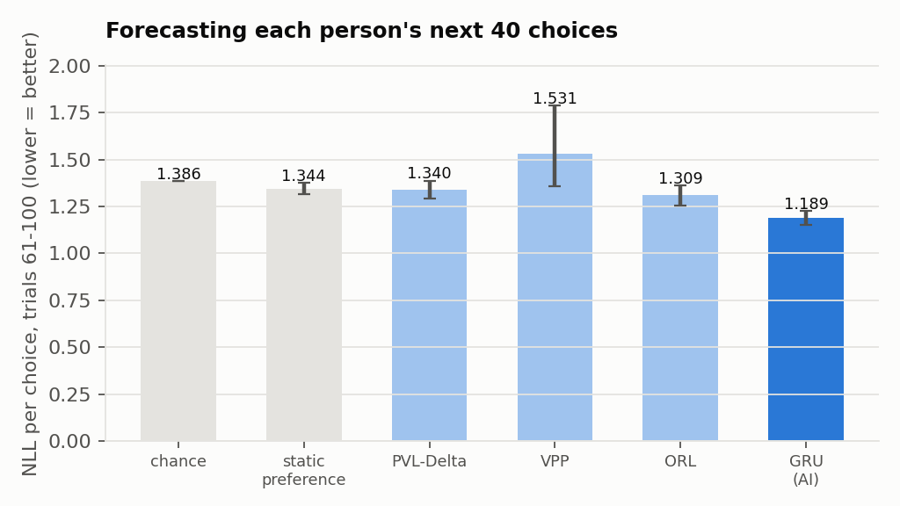
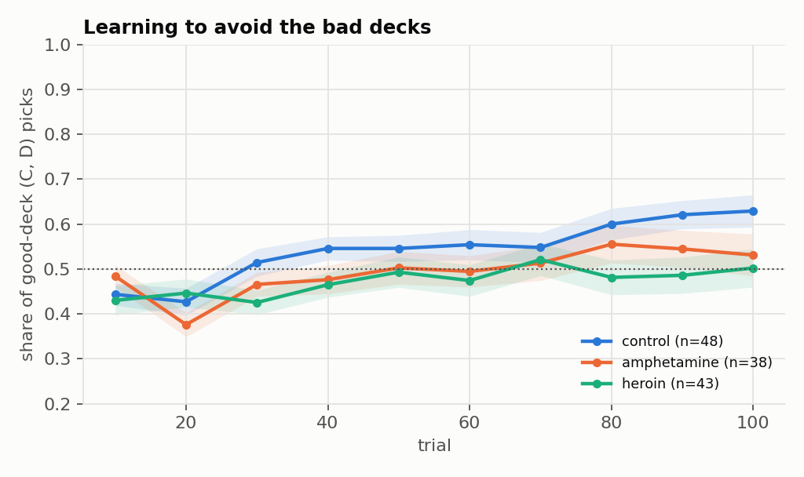
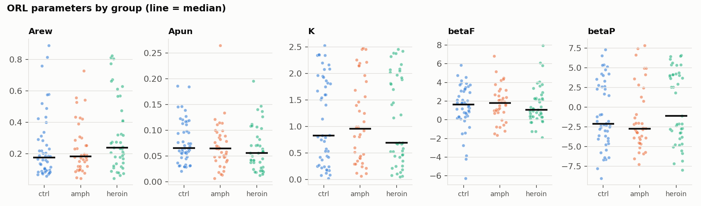
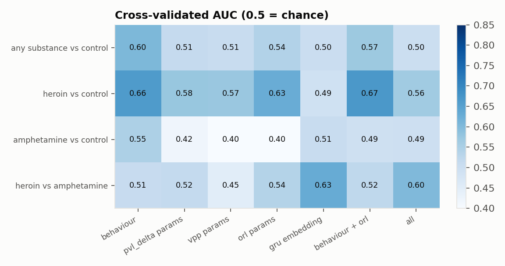
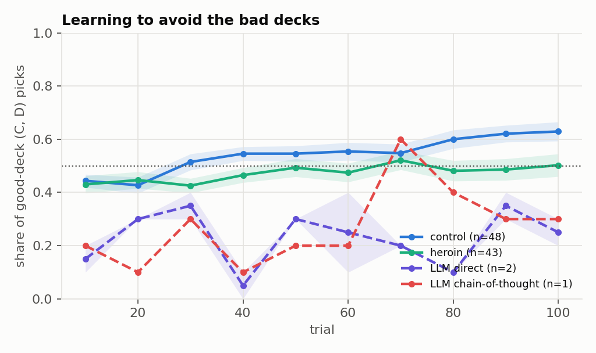
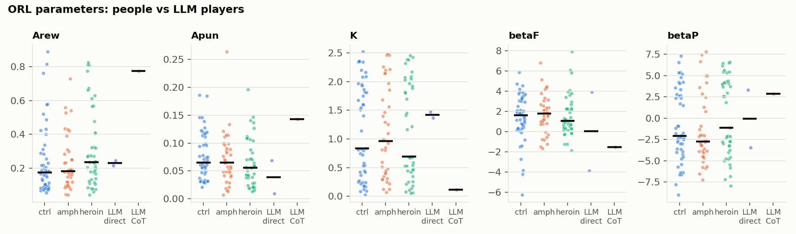

# Decision Phenotypes of Addiction

[](https://github.com/Praruj/addiction-decision-phenotypes/actions/workflows/ci.yml)
[](https://colab.research.google.com/github/Praruj/addiction-decision-phenotypes/blob/main/notebooks/colab_run.ipynb)


[](LICENSE)

**Psychology theory vs. a neural network: which better explains how heroin users,
amphetamine users and healthy people learn from wins and losses? And where does an LLM
that "thinks step by step" fall among them?**

Addiction is often described as a disorder of decision-making: taking a reward now despite
bigger losses later. The lab test for this is the **Iowa Gambling Task (IGT)**. Two decks
pay well but lose more over time; two pay less but win. This project uses 12,883 real choices
from 129 people (Ahn et al., 2014) and does four things:

1. Fits three **computational-psychiatry models** (PVL-Delta, VPP, ORL) to every person. Their
   parameters are a "decision phenotype": learning from rewards and from punishments, loss
   aversion, perseverance.
2. Trains a **GRU neural network** on other people and asks a fair question: which predicts a
   *new* person's next 40 choices better, theory or AI?
3. Tests whether behaviour, model parameters or the network's embedding can **tell substance
   users from controls**.
4. Lets an **LLM play the same 100 cards**, answering directly or with **chain-of-thought**, and
   places it in the human decision space.

The step-by-step reasoning behind every design choice, written before the results, is in
[docs/REASONING.md](docs/REASONING.md).

| | |
|---|---|
| **1.189 vs 1.309** | nats per choice: GRU vs best theory model (ORL), forecasting trials 61–100 of unseen people |
| **69%** | of people are predicted better by the GRU (Wilcoxon p < 0.001) |
| **ORL** | best-fitting theory model in all three groups (lowest BIC for 87 of 129 people) |
| **AUC 0.60** | substance users vs controls from one 100-trial game (permutation p = 0.05): a weak signal, not a diagnostic |



## Findings

**1. AI predicts behaviour better than theory, without ever seeing the person in training.**
Each cognitive model was fitted to a person's own first 60 choices, then predicted the next 40.
The GRU was trained only on *other* people and simply read this person's history. It still won:
0.12 nats per choice better than ORL (95% CI 0.08–0.17), 48% vs 44% top-1 accuracy. The
8-parameter VPP model did *worse than chance* on likelihood (1.531 vs 1.386). It overfits 60
trials and becomes overconfident. More theory is not automatically better prediction.

**2. Heroin users learned less, amphetamine users sat in between.**



| median | control | amphetamine | heroin |
|---|---|---|---|
| net score (good − bad picks, 100 trials) | +6 | +2 | −6 |
| money at the end | −$603 | −$945 | −$1,410 |
| share of deck B (frequent wins, rare huge loss) | 26% | 30% | 33% |

Heroin vs control: net score r = −0.32 (p = 0.009), money r = −0.37 (p = 0.002). Amphetamine vs
control was not significant. Across 11 behaviour features with Holm correction, nothing passes
0.05 (money: p = 0.096). In ORL terms, heroin users had a higher reward learning rate (median
0.24 vs 0.17) and a lower punishment learning rate (r = −0.25, p = 0.044, uncorrected): they
update more from wins than losses. This is a hint, not a confirmed effect, at this sample size.



**3. Predicting what someone does is not the same as knowing who they are.**



Logistic regression, 20 × repeated 5-fold CV. Heroin vs control reaches AUC 0.67 (behaviour +
ORL parameters). Amphetamine users cannot be told from controls (≤ 0.55). The GRU embedding,
the best *predictor* of choices, carries almost no group information (0.50). Most of what makes
choices predictable is individual style, not diagnosis. One short task is not a screening
tool.

**4. A small LLM plays like an exaggerated substance user, and reasoning first made it more confident, not better.** See [LLM experiment](#llm-experiment-chain-of-thought) (pilot, 3 games).

## LLM experiment: chain-of-thought

The IGT gives everyone the same k-th card from each deck (verified: 100% consistent in the data),
so the real task can be rebuilt for an AI agent. The agent gets the standard instructions, its
balance and only its last 10 draws. Two conditions differ in one thing: answer directly, or
reason in 2–3 sentences first. The deck is always read from the model's probabilities after
"I choose deck", so there is no text parsing. Its 100 choices then go through the same model
fits and the same human-trained classifier ("how substance-user-like is this player?").

**Pilot result** (`Qwen2.5-0.5B-Instruct` on the laptop CPU, 2 direct games + 1 chain-of-thought
game; ~1 h per direct game, 2.3 h for the reasoning game). Too few games for statistics, so
these are observations only:

| player | games | mean net score | "substance-user-like" (human-trained classifier) |
|---|---|---|---|
| people: control | 48 | +8.5 | 56%* |
| people: amphetamine | 38 | −1.2 | 64%* |
| people: heroin | 43 | −5.3 | 69%* |
| LLM, direct answer | 2 | −54 | 65% |
| LLM, chain-of-thought | 1 | −46 | 77% |

<sub>* in-sample for people, so only a reference point.</sub>

- The small LLM played **far worse than every human group**. It stuck with deck A (big wins, bigger
  losses) and never learned to switch to C/D.
- **Chain-of-thought made it more confident, not better.** Its average top-choice probability
  rose from 0.49 to 0.85. The reasoning chases recent wins ("deck B has the highest win rate so
  far") and ignores the rare large losses.
- In ORL terms, the reasoning player learned from rewards **5.4× faster** than from punishments
  (Arew 0.77 vs Apun 0.14). The ratio is 2.6× for controls and 4.3× for heroin users.




**Full run:** `Qwen2.5-3B-Instruct`, 10 games per condition, one click in the
[Colab notebook](notebooks/colab_run.ipynb) on a free T4 GPU. A 0.5B model can't really reason,
so whether chain-of-thought helps a capable model is still an open question here.

## Run it

```bash
python -m venv .venv && .venv/Scripts/activate      # Windows
pip install -r requirements.txt
python scripts/run_study.py          # ~35 min on a 2-core laptop CPU; --quick for a smoke test
python -m src.llm_agent --games 2    # LLM players (GPU recommended)
python scripts/analyze_llm.py
pytest -q                            # includes an ORL parameter-recovery test
```

```
src/data.py        load data, rebuild the payoff schedule
src/models.py      PVL-Delta, VPP, ORL in PyTorch, batched penalised-MLE fitting, simulation
src/rnn.py         GRU next-choice model (seed ensemble, early stopping)
src/behavior.py    model-free summaries (net score, win-stay / lose-shift, ...)
src/llm_agent.py   LLM plays the IGT, direct vs chain-of-thought
scripts/           run_study.py (human study), analyze_llm.py (LLM vs humans)
```

## Method notes

- **Fitting:** all 129 people × 12 random restarts in one PyTorch batch, Adam with exact
  gradients, weak N(0, 2²) prior on the unconstrained scale. Parameter recovery is tested on
  simulated players.
- **Forecast protocol:** theory models fitted to trials 1–60 of each person. GRU trained with
  5-fold cross-validation over people (3-seed ensemble), never on the test person. Both score
  trials 61–100 one step ahead. Bootstrap CIs over people.
- **Classification:** L2 logistic regression only (≈ 90 people per task). The GRU embedding
  is out-of-fold. Permutation test with 500 shuffles for the headline task.

## Data, ethics and limits

Data: Ahn, W.-Y., Vasilev, G., Lee, S.-H., Busemeyer, J. R., Kruschke, J. K., Bechara, A.,
& Vassileva, J. (2014). *Decision-making in stimulant and opiate addicts in protracted
abstinence: evidence from computational modeling with pure users.* Frontiers in Psychology, 5, 849.
[figshare](https://figshare.com/articles/dataset/IGT_raw_data_Ahn_et_al_2014_Frontiers_in_Psychology/1101324), CC BY 4.0,
included in `data/raw/` unchanged.

De-identified data, aggregate reporting only. With 129 people, group effects are small and
mostly do not survive multiple-comparison correction. They are reported as such.
Per-person MLE is noisier than hierarchical Bayes. Nothing here is a diagnostic tool.

---
Praruj Thapa · 2026 · [prarujthapa.com.np](https://www.prarujthapa.com.np)
